# Insurance Policy Management System with AI-Based Fraud Detection

An end-to-end Insurance Policy Management System built using **Java, Spring Boot, MySQL, HTML, CSS, JavaScript, and Python**. The application manages insurance policies, customers, agents, payments, and claims, with an AI-powered microservice that evaluates submitted claims for potential fraud risk.

## Key Features

### 1. Role-Based Management
- **Admin:** Manage customers, agents, policies, policy types, payments, and claims.
- **Agent:** Manage assigned customers, create policies, track commissions, and view policy-related claims.
- **Customer:** Register, manage profile, view policies, make payments, and submit claims.

### 2. Insurance Policy Management
- Manage different insurance policy types.
- Calculate insurance premiums based on sum assured, policy type, customer age, and policy duration.
- Create and manage insurance policies.
- Track policy details and status.

### 3. Claims Management
- Submit insurance claims with supporting attachments.
- View and manage claim requests.
- Approve or reject claims.
- Track claim status and approved amounts.

### 4. AI-Based Fraud Risk Detection
- Python-based machine learning microservice using a Random Forest classifier.
- Evaluates insurance claims using claim amount, policy details, customer age, claim history, and claim description.
- Generates a risk score between 0 and 1.
- Categorizes claims into risk levels.
- Provides contributing factors to help administrators understand potentially suspicious claims.
- Integrated with the Spring Boot backend through REST APIs.

**Model information:** The initial model is trained on 8,000 synthetic insurance claim records. Its recorded test ROC-AUC is approximately 0.765. This is an experimental baseline, not a measure of real-world fraud detection performance.
## Application Screenshots

### Authentication
| Login | Registration |
|---|---|
| 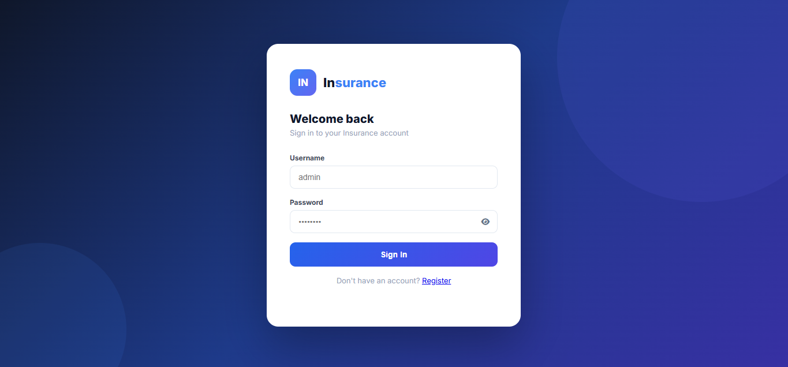 | 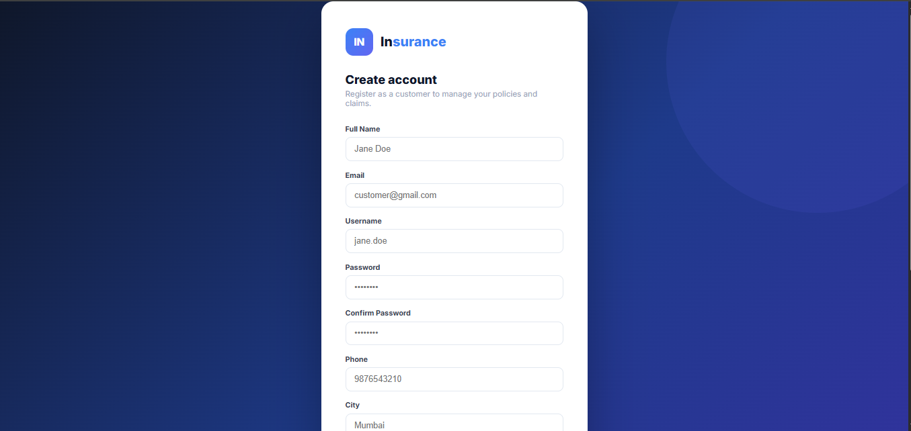 |

### Admin Dashboard
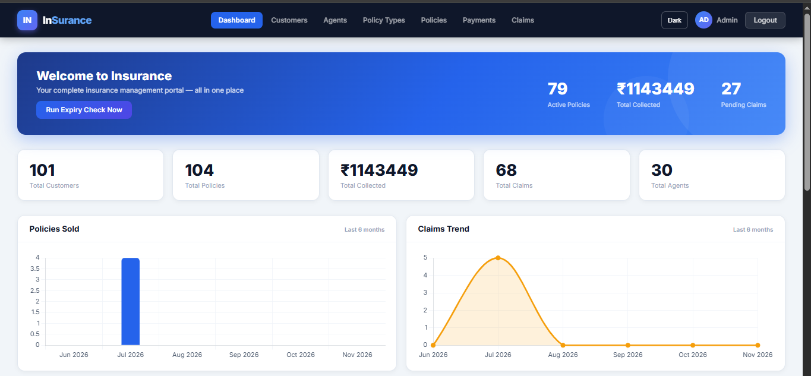

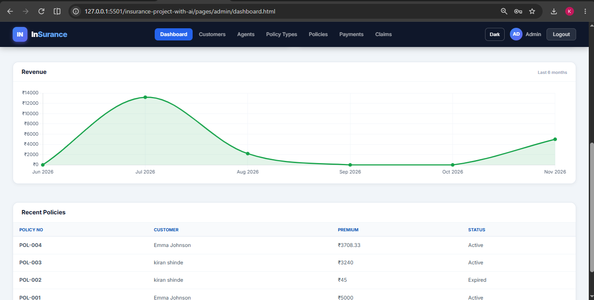

| Customer Details | Claim Requests |
|---|---|
| 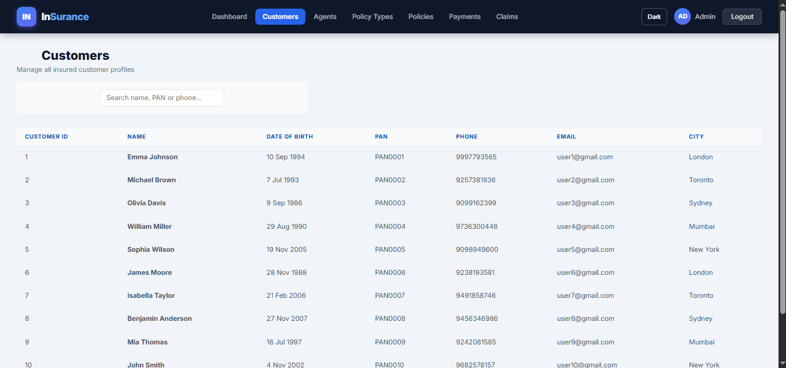 | 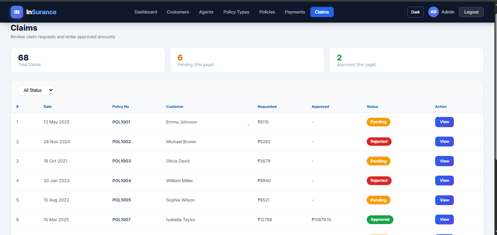 |


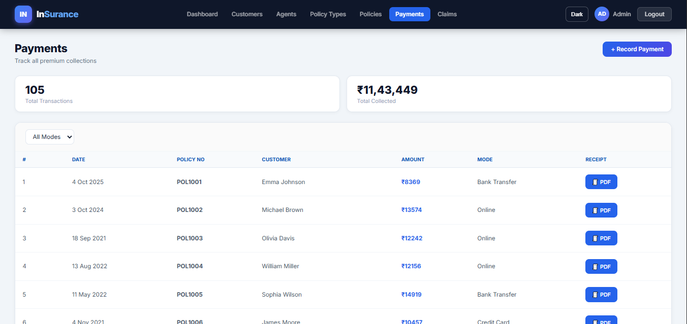

### Agent Dashboard
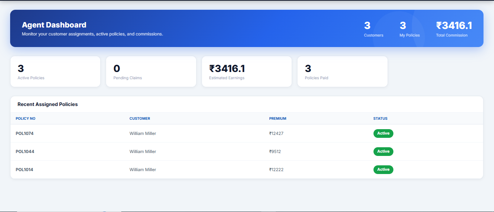

| Agent Customers | Agent Commission |
|---|---|
| 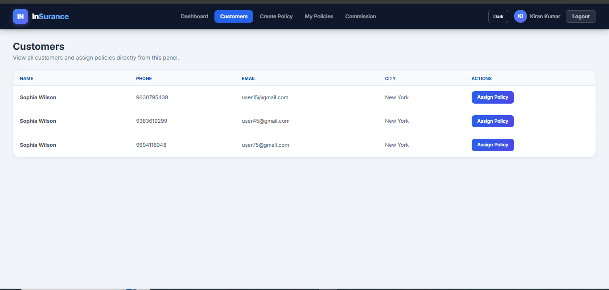 | 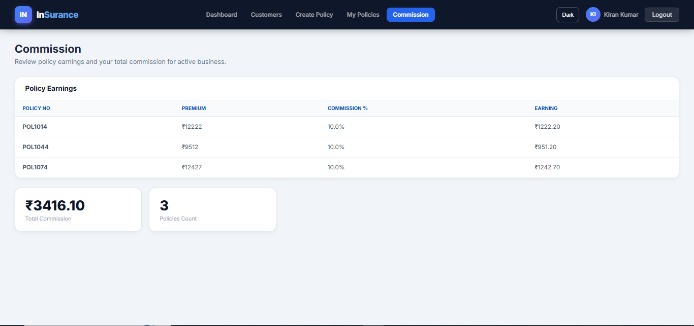 |

### Customer Dashboard
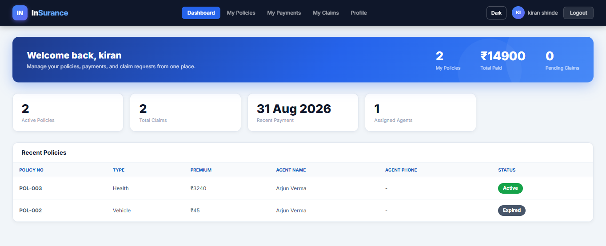

| Available Policies | Policy Details |
|---|---|
| 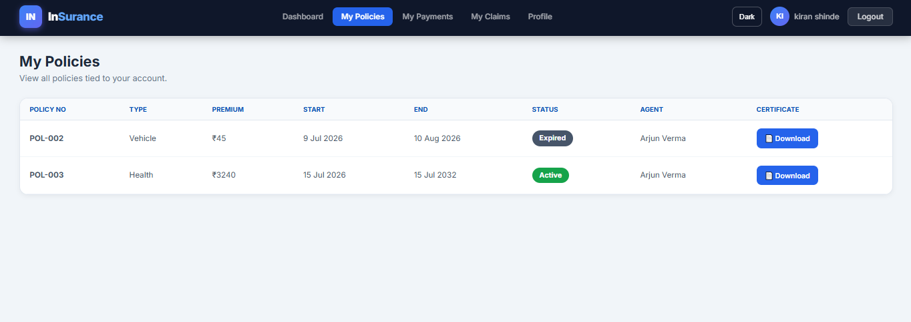 | 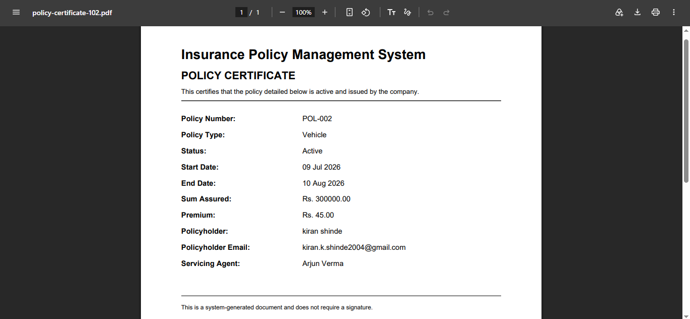 |

| Payment History | Claim Request |
|---|---|
| 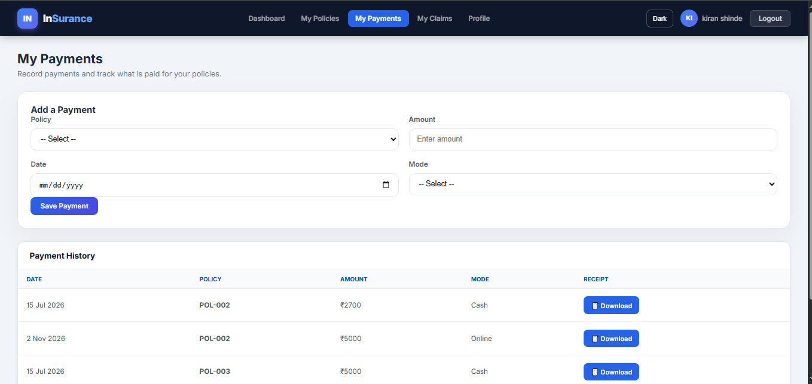 | 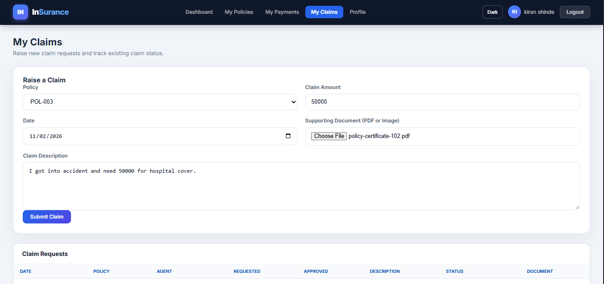 |

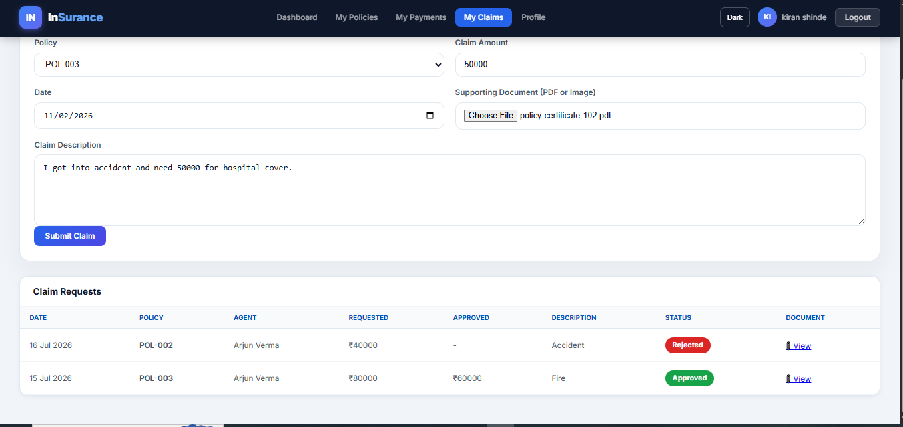
## Technology Stack

| Component | Technologies |
|---|---|
| Backend | Java 21, Spring Boot 3.3.5 |
| Security | Spring Security, JWT |
| Database | MySQL, Spring Data JPA, Hibernate |
| Frontend | HTML5, CSS3, JavaScript |
| AI/ML | Python, Scikit-learn, Random Forest |
| AI API | FastAPI, Uvicorn |
| Build Tool | Maven |
| API Documentation | Swagger UI |
| Testing | JUnit 5, Mockito, AssertJ, H2 |

## Project Architecture

```text
insurance-project-with-ai/
│
├── insurance-backend/
│   ├── src/
│   │   ├── main/
│   │   │   ├── java/com/insurance/
│   │   │   │   ├── config/
│   │   │   │   ├── controller/
│   │   │   │   ├── dto/
│   │   │   │   ├── exception/
│   │   │   │   ├── model/
│   │   │   │   ├── repository/
│   │   │   │   ├── security/
│   │   │   │   └── service/
│   │   │   └── resources/
│   │   └── test/
│   └── pom.xml
│
├── insurance-ai/
│   ├── data/
│   │   ├── generate_data.py
│   │   └── claims_synthetic.csv
│   ├── model/
│   │   ├── fraud_model.joblib
│   │   └── manifest.json
│   ├── service/
│   │   └── main.py
│   ├── train_model.py
│   └── requirements.txt
│
├── css/
├── js/
├── pages/
├── .gitignore
└── README.md
```

## Application Setup

### Prerequisites

Install the following:

- Java JDK 21
- Maven
- MySQL Server
- Python 3.10+
- Git
- VS Code or IntelliJ IDEA

### 1. Clone the Repository

```bash
git clone https://github.com/kiranshinde24/insurance-management-system.git
cd insurance-management-system
```

### 2. Configure the MySQL Database

Create the database:

```sql
CREATE DATABASE InsuranceDB;
```

Configure your database connection using environment variables:

```text
DB_URL=jdbc:mysql://localhost:3306/InsuranceDB?useSSL=false&serverTimezone=UTC&allowPublicKeyRetrieval=true
DB_USERNAME=root
DB_PASSWORD=your_mysql_password
JWT_SECRET=your_long_random_secret
```

Set up the required initial database tables using your database schema. Then run the migration script:

```text
insurance-backend/src/main/resources/db-migration.sql
```

Configure email credentials through environment variables if email functionality is required. Never commit passwords, app passwords, or JWT secrets.

### 3. Run the Spring Boot Backend

Open a terminal:

```bash
cd insurance-backend
mvn clean install
mvn spring-boot:run
```

Backend runs at:

`http://localhost:8080`

### 4. Run the AI Microservice

Open another terminal from the project root:

```bash
cd insurance-ai
python -m venv venv
```

Activate the environment on Windows:

```cmd
venv\Scripts\activate
```

Install dependencies:

```bash
pip install -r requirements.txt
```

Start the AI service:

```bash
uvicorn service.main:app --host 0.0.0.0 --port 8000
```

AI service runs at:

`http://localhost:8000`

Health check:

`http://localhost:8000/health`

### 5. Run the Frontend

Open the project root in VS Code and use the Live Server extension to launch:

```text
pages/login.html
```

The frontend communicates with the Spring Boot backend running on port 8080.

## API Documentation

Swagger UI is available after starting the backend:

`http://localhost:8080/swagger-ui.html`

OpenAPI specification:

`http://localhost:8080/v3/api-docs`

The AI microservice provides its API documentation at:

`http://localhost:8000/docs`

## Testing

The Spring Boot backend includes unit and integration tests using JUnit 5, Mockito, AssertJ, and H2.

Run tests from the backend directory:

```bash
mvn test
```

## AI Model Training

The AI model can be retrained using the included synthetic claim dataset.

From the `insurance-ai` directory:

```bash
python data/generate_data.py
python train_model.py
```

The training pipeline uses claim-related features to learn patterns associated with potentially suspicious claims.

## Security Notes

- Authentication uses JWT-based security.
- Passwords are handled using secure password hashing.
- Protected APIs require authentication.
- Configure database, JWT, and email credentials through environment variables.
- Do not commit production credentials, secrets, or personal customer data.

## Future Improvements

- Improve fraud detection using real, appropriately anonymized insurance claim data.
- Expand automated testing and model evaluation.
- Add deployment using Docker.
- Introduce CI/CD automation.
- Improve monitoring and reporting for claim risk analysis.

## Author

**Kiran Shinde**

- GitHub: [@kiranshinde24](https://github.com/kiranshinde24)
- LinkedIn: [Kiran Shinde](https://www.linkedin.com/in/kiran-shinde24/)

---

*Built as an end-to-end project combining backend development, database management, frontend development, application security, and machine learning.*